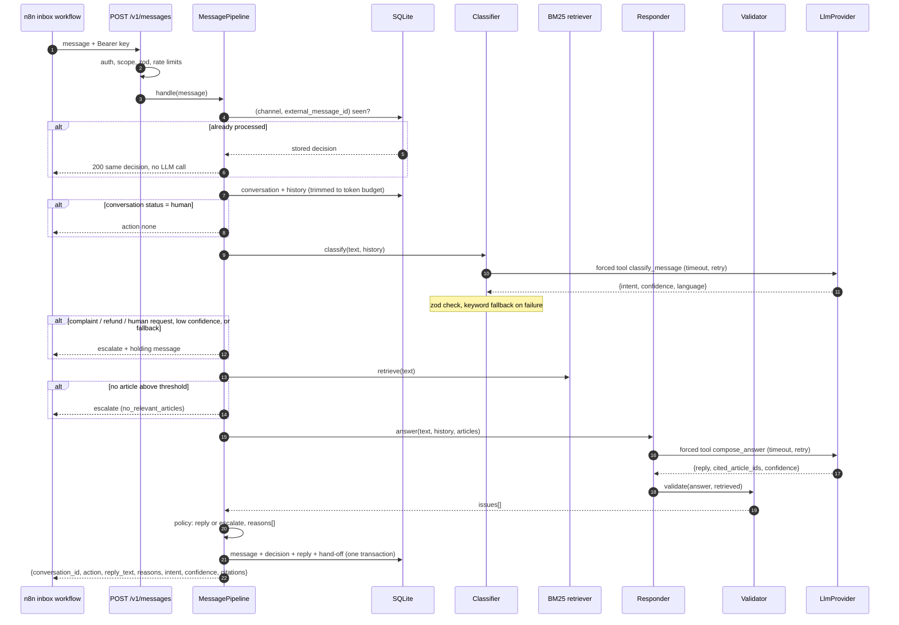
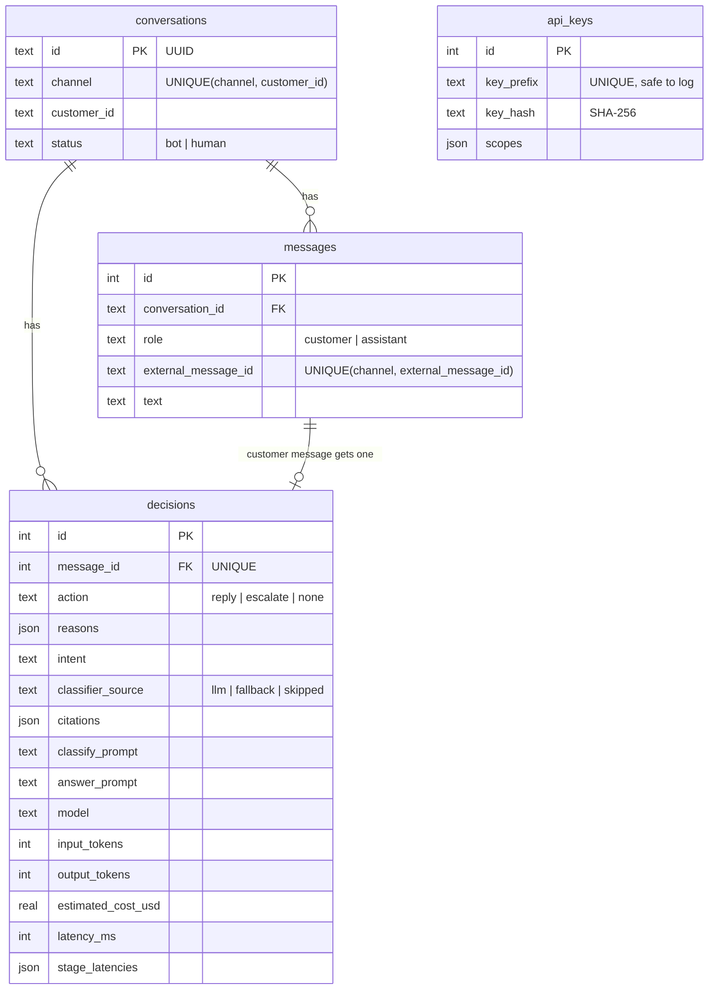

# ai-support-service

[](../../actions/workflows/ci.yml)

Customer-support message service that classifies intent with an LLM, answers only from a vetted
knowledge base, validates the output, and escalates to a human when it should.

> Portfolio project. All data in this repository (business, knowledge base, prices, customers,
> evaluation messages) is fictional sample data.

## Overview

Small service businesses get the same questions on WhatsApp and Instagram all day: prices,
free dates, deposits, rescheduling. An LLM can answer these well, but only if it cannot invent a
price, promise a refund, or keep chatting after a customer asked for a person.

This service is the decision step behind an inbox. It receives one customer message, decides
whether to **reply**, **escalate** to a human (with a short holding message), or stay **silent**
because a human already took over, and records why. The sample knowledge base belongs to a
fictional event-decoration business in Bekasi ("Sekar Dekorasi"), written in Indonesian.

The focus is the engineering around the model: structured output, grounding, output validation,
deterministic escalation rules, idempotency, timeouts and retries, cost and latency tracking.

## Features

- `POST /v1/messages`: classify, retrieve, answer, validate, decide; idempotent on
  `(channel, external_message_id)` so webhook retries never trigger a second LLM call.
- Intent classification with forced tool use and a JSON schema, validated with zod; keyword
  fallback classifier when the LLM fails or times out (marked as `fallback`).
- BM25 retrieval implemented in the repo over 11 Markdown articles, with an Indonesian and
  English tokenizer; below a score threshold the bot does not answer.
- Answers grounded in retrieved articles only, returned as `{reply, cited_article_ids, confidence}`.
- Output validation: schema, citations, prices and percentages, length, forbidden promises.
- Escalation policy with machine-readable `reasons[]` on every decision.
- Human hand-off: an escalation or an agent switches the conversation to `human` and the bot stays
  silent until it is handed back.
- Versioned prompt files; prompt versions, model, tokens, estimated cost and per-stage latency
  stored per message. `GET /v1/metrics` aggregates them.
- API keys stored as SHA-256 hashes with scopes; per-key and per-customer rate limits.
- `LLM_PROVIDER=fake`: deterministic, offline mode for local runs and tests.
- `npm run eval`: intent accuracy and confusion summary on a labelled dataset.

## Tech stack

Node 22, TypeScript (strict), Fastify 5, zod 4, better-sqlite3 (SQLite), `@anthropic-ai/sdk`,
`@fastify/rate-limit`, pino, vitest, ESLint and Prettier.

## Architecture

Layers: **routes** (HTTP, auth, validation) → **MessagePipeline** (orchestration, persistence
transaction) → **components** (classifier, retriever, responder, validator, policy) →
**repositories** (SQLite). Components depend on the `LlmProvider` interface, implemented by
`AnthropicProvider` and `FakeProvider`.



The policy is consulted after each stage, so a message that is going to a human never costs a
second LLM call. Greetings are answered from a template without retrieval.

## Guardrails

Every guardrail below exists in code and has a test.

| Guardrail                                                                       | Code                                                                                                                                                                                            | Test                                                                                                                                                          |
| ------------------------------------------------------------------------------- | ----------------------------------------------------------------------------------------------------------------------------------------------------------------------------------------------- | ------------------------------------------------------------------------------------------------------------------------------------------------------------- |
| Webhook replay returns the stored decision without calling the LLM              | `UNIQUE (channel, external_message_id)` in [`src/db/schema.ts`](src/db/schema.ts); `MessagePipeline.handle`/`persist` in [`src/pipeline/message-pipeline.ts`](src/pipeline/message-pipeline.ts) | `tests/pipeline.test.ts` › idempotency (replay, concurrent duplicates, per-channel ids)                                                                       |
| Classifier output is schema-checked; forced tool call                           | `classificationSchema`, `CLASSIFY_TOOL` in [`src/pipeline/classifier.ts`](src/pipeline/classifier.ts); `tool_choice` in [`src/llm/anthropic-provider.ts`](src/llm/anthropic-provider.ts)        | `tests/classifier.test.ts` › forces the classify tool…, falls back when the tool input fails schema validation; `tests/anthropic-provider.test.ts`            |
| LLM failure or timeout → keyword fallback, marked, then escalated               | `IntentClassifier.fallback`; [`src/pipeline/keyword-classifier.ts`](src/pipeline/keyword-classifier.ts); `checkClassification` in [`src/pipeline/policy.ts`](src/pipeline/policy.ts)            | `tests/pipeline.test.ts` › marks the keyword fallback and escalates when classification times out                                                             |
| Per-call timeout; retry with backoff and jitter only on 429/5xx/timeout         | `withRetry`, `runWithTimeout`, `backoffDelay` in [`src/llm/retry.ts`](src/llm/retry.ts); `LlmError.retryable` in [`src/llm/provider.ts`](src/llm/provider.ts)                                   | `tests/retry.test.ts`; `tests/classifier.test.ts` › retries a 5xx and then uses the model result                                                              |
| Complaints, refund requests and requests for a human always go to a human       | `ALWAYS_ESCALATE` in [`src/pipeline/policy.ts`](src/pipeline/policy.ts)                                                                                                                         | `tests/pipeline.test.ts` › escalates intent … and never drafts an answer                                                                                      |
| Low classifier or answer confidence escalates (thresholds from env)             | `checkClassification`, `checkAnswer` in [`src/pipeline/policy.ts`](src/pipeline/policy.ts)                                                                                                      | `tests/pipeline.test.ts` › escalates when classifier / answer confidence is below the threshold                                                               |
| No relevant article → no improvised answer                                      | score threshold in [`src/retrieval/retriever.ts`](src/retrieval/retriever.ts); `checkRetrieval` in `policy.ts`                                                                                  | `tests/pipeline.test.ts` › escalates instead of improvising…; `tests/retrieval.test.ts` › returns nothing for topics…                                         |
| Answer prompt contains only retrieved articles                                  | `Responder.respond` in [`src/pipeline/responder.ts`](src/pipeline/responder.ts)                                                                                                                 | `tests/pipeline.test.ts` › replies from the knowledge base with citations…                                                                                    |
| Cited ids must be a subset of the retrieved ids (and at least one)              | `checkCitations` in [`src/pipeline/validator.ts`](src/pipeline/validator.ts)                                                                                                                    | `tests/validator.test.ts` › blocks a citation…, requires at least one citation; `tests/pipeline.test.ts` › blocks a citation outside the retrieved set        |
| Every price/percentage in the reply must appear in a cited article              | `checkAmounts` in `validator.ts`; [`src/pipeline/amounts.ts`](src/pipeline/amounts.ts)                                                                                                          | `tests/validator.test.ts` › blocks a hallucinated price…, …only in an article the reply did not cite; `tests/pipeline.test.ts` › blocks a hallucinated price… |
| Reply length bounds                                                             | `checkLength` in `validator.ts`                                                                                                                                                                 | `tests/validator.test.ts` › enforces reply length bounds                                                                                                      |
| No guaranteed refunds, confirmed bookings or discounts                          | `FORBIDDEN_PROMISES` in `validator.ts`                                                                                                                                                          | `tests/validator.test.ts` › blocks the forbidden promise…, allows policy wording…                                                                             |
| Human hand-off keeps the bot silent                                             | `checkConversation` in `policy.ts`; hand-off in `persist`; [`src/http/routes/conversations.ts`](src/http/routes/conversations.ts)                                                               | `tests/pipeline.test.ts` › human hand-off; `tests/http.test.ts` › lets an agent take over and hand the conversation back                                      |
| Every decision records `reasons[]`                                              | `Verdict` in `policy.ts`; `decisions.reasons`                                                                                                                                                   | `tests/pipeline.test.ts` › records every applicable reason, not just the first                                                                                |
| API keys hashed, constant-time compare, scopes; unscoped routes fail at startup | [`src/auth/api-keys.ts`](src/auth/api-keys.ts); [`src/http/auth-plugin.ts`](src/http/auth-plugin.ts)                                                                                            | `tests/http.test.ts` › authentication and scopes                                                                                                              |
| Rate limits per API key and per customer                                        | [`src/http/rate-limits.ts`](src/http/rate-limits.ts)                                                                                                                                            | `tests/http.test.ts` › rate limiting                                                                                                                          |
| API keys never logged; customer text only when enabled                          | `redact` in [`src/app.ts`](src/app.ts); `logCustomerText` in `message-pipeline.ts`                                                                                                              | `tests/logging.test.ts`                                                                                                                                       |

The prompts also tell the model to treat customer text as data, but that is a soft measure; the
checks above are what actually stop a bad reply from being sent.

## Database



CHECK constraints cover enums, confidence ranges, non-negative counters and `json_valid` on JSON
columns. The schema is applied on start-up and tracked with `PRAGMA user_version`.

## API

Full contract, error codes and reason codes: [`docs/api.md`](docs/api.md).

| Method | Path                            | Scope            |
| ------ | ------------------------------- | ---------------- |
| POST   | `/v1/messages`                  | `messages:write` |
| POST   | `/v1/conversations/:id/handoff` | `messages:write` |
| GET    | `/v1/conversations/:id`         | `admin:read`     |
| GET    | `/v1/metrics?from&to`           | `admin:read`     |
| GET    | `/health`                       | none             |

### How `omnichannel-inbox-automation` calls this service

The n8n workflows normalise WhatsApp and Instagram webhooks and send one HTTP request per inbound
message:

```http
POST /v1/messages
Authorization: Bearer sup_xxxxxxxx_...
X-Request-Id: <n8n execution id>
Content-Type: application/json

{"channel":"whatsapp","external_message_id":"wamid.HBgL...","customer_id":"6281200000001",
 "customer_name":"Rina","text":"kak brp harga paket anggrek?","received_at":"2026-10-09T10:00:00+07:00"}
```

```json
{
  "conversation_id": "f3b4...",
  "action": "reply",
  "reply_text": "...",
  "reasons": ["answered_from_knowledge_base"],
  "intent": "pricing_question",
  "confidence": 0.85,
  "citations": [{ "article_id": "paket-dan-harga", "title": "Paket dekorasi dan harga" }]
}
```

A Switch node on `action` sends `reply_text` (`reply`), sends it and notifies the team
(`escalate`), or stops (`none`). On 5xx or timeouts the workflow retries with the same
`external_message_id`, which is safe because of idempotency; on 429 it waits for `Retry-After`.
When an agent is done, the inbox calls the hand-off endpoint with `{"status":"bot"}`.

## Getting started

Requires Node 22.12 or newer.

### Run in fake mode (no API key, no network)

```bash
npm ci
npm run create-key -- --name local --scopes messages:write,admin:read   # prints the key once
npm run dev                                                             # http://localhost:8083

curl -s -X POST localhost:8083/v1/messages \
  -H "Authorization: Bearer <key>" -H "Content-Type: application/json" \
  -d '{"channel":"whatsapp","external_message_id":"wamid.1","customer_id":"6281200000001",
       "text":"kak brp harga paket anggrek?","received_at":"2026-10-09T10:00:00+07:00"}'
```

Without a `.env` file the defaults apply: `LLM_PROVIDER=fake`, SQLite at `./data/support.db`.
The fake provider classifies with the keyword rules and answers by quoting the best-matching
line of the top retrieved article, so the replies are mechanical but the whole pipeline
(retrieval, validation, policy, persistence, metrics) runs for real. Try a complaint
(`kecewa bgt bunganya layu`), a topic outside the knowledge base (`kak catering juga ada?`), and
a follow-up from the same customer after an escalation.

### Run with Claude

```bash
cp .env.example .env
# set LLM_PROVIDER=anthropic, ANTHROPIC_API_KEY=..., and optionally LLM_MODEL
# set LLM_PRICE_INPUT_PER_MTOK / LLM_PRICE_OUTPUT_PER_MTOK from the provider's current price list
npm run dev
```

`.env` is loaded automatically when present; real environment variables take precedence.
Production: `npm run build && npm start`.

### Configuration

All variables with defaults are listed in [`.env.example`](.env.example). The ones that change
behaviour most:

| Variable                                                | Default                    | Effect                                                       |
| ------------------------------------------------------- | -------------------------- | ------------------------------------------------------------ |
| `LLM_PROVIDER`                                          | `fake`                     | `fake` or `anthropic`                                        |
| `LLM_MODEL`                                             | `claude-haiku-5-5`         | Model id sent to the API                                     |
| `LLM_PRICE_INPUT_PER_MTOK`, `LLM_PRICE_OUTPUT_PER_MTOK` | `0`                        | USD per million tokens for cost estimates                    |
| `LLM_TIMEOUT_MS`, `LLM_MAX_ATTEMPTS`                    | `15000`, `3`               | Per-attempt timeout and attempts per LLM call                |
| `MIN_CLASSIFIER_CONFIDENCE`, `MIN_ANSWER_CONFIDENCE`    | `0.6`, `0.7`               | Escalation thresholds                                        |
| `RETRIEVAL_MIN_SCORE`, `RETRIEVAL_TOP_K`                | `2.5`, `3`                 | BM25 cut-off and number of articles given to the model       |
| `HISTORY_TOKEN_BUDGET`                                  | `1500`                     | Earlier turns sent to the model, estimated as characters / 4 |
| `CLASSIFY_PROMPT_VERSION`, `ANSWER_PROMPT_VERSION`      | `classify.v1`, `answer.v1` | Prompt file in `prompts/`                                    |
| `LOG_CUSTOMER_TEXT`                                     | `false`                    | Include message text in decision logs                        |

### Tests and checks

```bash
npm test           # vitest, FakeProvider scripted per test, in-memory SQLite
npm run lint       # ESLint (type-checked rules) + Prettier
npm run typecheck
```

### Evaluating the classifier

```bash
LLM_PROVIDER=anthropic ANTHROPIC_API_KEY=... npm run eval
```

Runs the classifier over [`data/eval/intents.jsonl`](data/eval/intents.jsonl) (30 fictional,
labelled messages: casual and formal Indonesian, some English) and prints intent and language
accuracy, a confusion summary, the misclassified messages, and token usage. Results depend on the
model and prompt version, so none are quoted here; run it after changing either. With the default
fake provider it measures only the keyword rules.

## Design decisions

- **Forced tool use for structured output.** Both LLM calls force a single tool whose input
  schema is generated from the zod schema that later validates the result, so the shape is
  defined once. Validation still runs because the API output is never trusted.
- **BM25 instead of embeddings.** Eleven short articles do not need a vector database. BM25 is
  under 100 lines, deterministic, and its scores are explainable when tuning the threshold. A small
  synonym map bridges chat abbreviations and English terms to the Indonesian articles.
- **Escalate rather than retry the answer.** A failed validation is not sent back to the model for
  another attempt; it goes to a human with the reason. Simpler, and cheaper in the cases that
  matter most.
- **Amount check by value, not by string.** `Rp 4.500.000`, `Rp4,5 juta` and `4.5jt` normalise to
  the same value, so the check tolerates wording but not invented numbers.
- **Escalation flips the conversation to `human`.** After a holding message the bot should not
  keep answering; an agent hands it back explicitly.
- **SQLite with one write transaction per message.** Enough for one instance; the idempotency key
  and the decision are written together so retries are always safe.
- **Model and prices are configuration.** Nothing in code assumes a model or current pricing.

## Limitations and future work

- Rate-limit counters and the in-flight request map are in memory, so they are per process.
  Several instances would need the plugin's Redis store and a shared lock; SQLite would also be
  replaced by a server database.
- Token counts for history trimming are a characters / 4 estimate, not a real tokenizer.
- The amount check covers money and percentages; it does not verify plain numbers such as days
  or guest counts. Forbidden-promise detection is a short regex list and will miss rephrasings.
- Retrieval is lexical: synonyms outside the map and typos lower recall (which escalates, the safe
  direction).
- No admin UI, key revocation endpoint, or data retention job yet; message text is stored in
  plain form in SQLite.
- The evaluation set is small and only covers intent classification, not answer quality.

## License

MIT, see [LICENSE](LICENSE).
