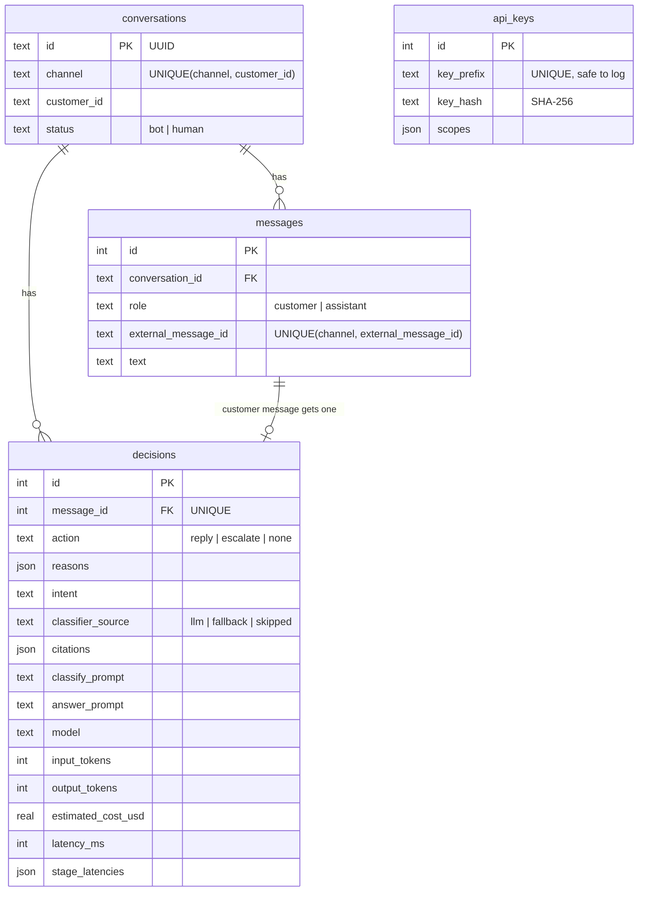

# Architecture notes

The request sequence is in the [README](../README.md#architecture). This page covers the schema
and two smaller design decisions.

## Database

CHECK constraints cover enums, confidence ranges, non-negative counters and `json_valid` on JSON
columns. The schema is applied on start-up and tracked with `PRAGMA user_version`.

## Further design decisions

- **SQLite with one write transaction per message.** Enough for one instance; the idempotency key
  and the decision are written together so retries are always safe.
- **Model and prices are configuration.** Nothing in code assumes a model or current pricing.
